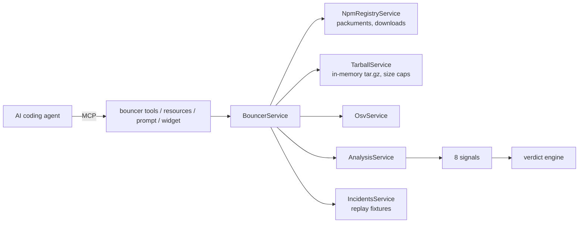

# Dep Bouncer

**`npm install`, reimagined for AI agents.**

Dep Bouncer is an MCP server an AI coding agent calls *before* it installs or upgrades an npm
package. It compares the release with **the package's own history** (who published it, whether
CI signed it, what runs at install time, which dependencies appeared, what code changed) and
returns **ALLOW / REVIEW / BLOCK** with the evidence, plus **the version to install instead**.

- **Live MCP endpoint:** `https://dep-bouncer-6ad22414-giberelin-heapify-global-community.app.nitrocloud.ai/mcp`
- **Demo video:** _link coming_
- **Track:** Developer Tools · **Product reimagined:** npm (`npm install` / `npm audit`)
- Built with [NitroStack](https://nitrostack.ai), deployed on NitroCloud.

---

## The problem: agents install in seconds, advisories arrive in hours

AI coding agents now run `npm install` for us, mid-task, from the terminal. npm installs
whatever was published a minute ago, and `npm audit` only knows about *published advisories*.
For real hijacks, the free advisory database (OSV) needed hours to catch up:

| Hijack | Weekly downloads (Oct 2026) | First OSV entry after publish | What `npm audit` said meanwhile |
|---|---:|---:|---|
| **axios 1.14.1** (Mar 2026) | 119 M | **2.9 h** (MAL-2026-2307) | found 0 vulnerabilities |
| **keyv 6.0.0** (Aug 2026) | 167 M | **1.7 h** (MAL-2026-11524) | found 0 vulnerabilities |
| **chalk 5.6.1** (Sep 2025) | 496 M | **4.0 h** (MAL-2025-46969) | found 0 vulnerabilities |
| **@ctrl/tinycolor 4.1.1** (Sep 2025) | 4.7 M | **3.8 h** (MAL-2025-47141) | found 0 vulnerabilities |
| **nx 21.5.0** (Aug 2025) | 10.8 M | **18.2 h** (MAL-2025-41443) | found 0 vulnerabilities |

_Lags measured from the npm registry's publish times and OSV's `published` field._ Two of these
attacks went straight for AI agents: nx's malware ran the victim's `claude`, `gemini` and `q`
CLIs with permission checks disabled, and the keyv worm planted Claude Code `SessionStart` hooks.

## Before / after

| | Before: agent + npm | After: agent + Dep Bouncer |
|---|---|---|
| `axios@1.14.1`, 30 min after the hijack | `npm audit`: **found 0 vulnerabilities**; postinstall of `plain-crypto-js` drops a RAT | **BLOCK**: published by a personal account instead of the project's CI; provenance gone; new dependency `plain-crypto-js` is 22 minutes old, copies the name `crypto-js`, runs a postinstall and is never imported by axios. **Install axios@1.14.0 instead.** |
| `keyv@6.0.0` (valid provenance!) | installs; `preinstall` runs an obfuscated loader | **BLOCK**: new `preinstall` running a new file; obfuscated loader that spawns processes and downloads a runtime; 700 KB encrypted blob. **Install 5.6.0.** |
| `chalk@6.0.1` today | installs | **ALLOW**: consistent with its own history |

## Why this needs MCP

A verdict is not one lookup. For each request the agent's tool call makes Dep Bouncer gather
the registry history (publishers, provenance, publish times), download and diff two tarballs,
look up every newly added dependency, check the name against popular packages, and query OSV.
Then the agent **acts** on the answer: it installs the safe version, asks the human (REVIEW),
or refuses (BLOCK). The `safe_install` prompt teaches any agent that loop.

## Tools, resources, prompt, widget

| MCP surface | What it does |
|---|---|
| `bouncer_check_package` | Vet a release (or `latest`) before `npm install`. Verdict, evidence, what npm audit / OSV / a cooldown say, safe version. |
| `bouncer_check_upgrade` | Vet a version bump and show what changed between the two versions. |
| `bouncer_safe_version` | Newest version in a semver range that passes every check, and why newer ones were skipped. |
| `bouncer_check_manifest` | Vet every dependency of a package.json at the version npm would install **today**. Runs as an **MCP Task** with live progress. |
| `bouncer_review_install_scripts` | npm 12 asks you to approve install scripts but only shows the command. This explains each one: APPROVE / REVIEW / DENY. |
| `bouncer_replay_incident` | Replay a real hijack (axios, keyv, chalk, nx, tinycolor) as an agent met it, 30 minutes after publication. |
| `bouncer://policy` | Signals, weights and thresholds. |
| `incidents://list` | The replayable incidents and their OSV lag. |
| `safe_install` (prompt) | Rules that make an agent call Dep Bouncer before every dependency change and act on the verdict. |
| `verdict-card` (widget) | Visual verdict with evidence, the "what other checks say" panel and a one-click "use the safe version". |

## How it decides

| Signal | Looks for | Caught |
|---|---|---|
| `publisher-change` | A personal account publishing where CI (npm trusted publishing) always did; a never-seen publisher | axios |
| `provenance-drop` | Previous releases were built and signed by CI; this one was not | axios, nx |
| `install-script` | A new or changed `preinstall` / `install` / `postinstall` | keyv, nx, tinycolor |
| `new-deps` | New dependencies that are days old, run install scripts, copy a popular name, or are never imported (phantom) | axios |
| `code-diff` | Code **new to this release**: obfuscation, process execution, credential paths, exfiltration hosts, wallet hooks, AI-agent abuse (`--dangerously-skip-permissions`, `SessionStart` hooks), persistence, packed payloads | chalk, keyv, nx, tinycolor |
| `release-timing` | Published in the last 24 h; bursts of versions | all (weak alone) |
| `name-check` | Look-alikes of ~2,400 popular names with few downloads or a recent creation date | typosquats, hallucinated names |
| `known-advisory` | OSV `MAL-` entries for the exact version | anything already reported |

Weights: warn 15, high 35, critical 70. **Any critical finding blocks**; otherwise the sum
decides: < 30 ALLOW, 30–69 REVIEW, ≥ 70 BLOCK. Packages that don't exist (hallucinated names),
versions npm removed, and npm's `-security` placeholders are blocked outright.

## Benchmark

`npm run bench` replays the five hijacks and checks the latest release of 60 popular
packages (presumed healthy) to measure false positives. Latest run ([bench/RESULTS.md](bench/RESULTS.md)):

- **Replayed hijacks: 5 / 5 BLOCK**, none of which OSV knew about at the replay time.
- **60 popular releases: 58 ALLOW, 2 REVIEW, 0 BLOCK.** Both REVIEWs were published less than
  24 hours before the run, with one weak code finding each.

The first run flagged webpack and vitest as BLOCK; that led to the "new to the whole package"
rule in `code-diff` (bundlers rename chunk files every release). Numbers will move as npm
does; CI re-runs the replays on every push.

## How it compares (honestly)

| Tool | When it acts | Gap Dep Bouncer fills |
|---|---|---|
| `npm audit`, Dependabot, OSV | After an advisory is published | Advisories arrived 1.7–18 h after these hijacks |
| Socket Firewall Free, Aikido Safe Chain | At install, against the vendor's malware feed | Blocklists: they block once the vendor has flagged a package. Dep Bouncer judges the release from its own history, explains why, and names the version to use. Complementary. |
| Cooldowns (`min-release-age`, pnpm 11 default) | Hold every release for N hours | Would have held all five hijacks, and every urgent security fix too. Dep Bouncer lets clean fresh releases through and shows cooldown status. |
| npm 12 script blocking | Skips install scripts until approved | Approval without explanation; does nothing for code that runs on import (chalk). |
| Provenance | Proves where a release was built | keyv 6.0.0 had **valid** provenance. |
| Socket GitHub app | On pull requests | Agents install from the terminal, not through PRs. |
| Socket MCP `depscore`, slopsquat checkers | Scores, fake names | Scores without evidence or a safe version; fake names only. |

## Replayed incidents are labelled reconstructions

npm removed the malicious versions. Each replay uses the **real last-good release** (manifests,
files, publish times, fetched from the registry by `scripts/build-fixtures.mjs`) plus the
documented changes of the bad release, with **benign stand-in code** that only mimics the
structure of the attack. Every stand-in file starts with
`/* Dep Bouncer reconstruction: benign stand-in, not real malware. */`, and every replay result
says what is real and what was reconstructed, with sources. No malware was downloaded or stored.

## Architecture



```
src/
  modules/registry/    npm registry, downloads, OSV clients; tar.gz parser; semver; TTL cache
  modules/analysis/    signal contract, signals/*, code patterns, name similarity, verdict
  modules/incidents/   reconstructed incident fixtures + replay service
  modules/bouncer/     MCP tools, resources, prompt; orchestration service
  health/              system, npm registry and OSV health checks
  widgets/app/verdict-card/   the verdict widget
scripts/               build-fixtures, build-popular, benchmark, copy-assets
test/                  node:test suites (signals, parser, replays, semver, ...)
```

NitroStack features used: DI modules and `@Injectable`, `@Tool` / `@Resource` / `@Prompt`,
`@Widget`, `@RateLimit`, MCP Tasks (`taskSupport`, progress, cancellation), `@HealthCheck`.

**Safety:** Dep Bouncer never executes package code; tarballs come only from
`registry.npmjs.org` and are parsed in memory (25 MB compressed, 60 MB extracted, 5,000 files,
path-traversal checks). No API keys, no user data stored.

## Use it

**Any MCP client (Claude, ChatGPT, Cursor, NitroChat):** add a remote MCP server with the URL
above. Cursor `~/.cursor/mcp.json`:

```json
{ "mcpServers": { "dep-bouncer": { "url": "https://dep-bouncer-6ad22414-giberelin-heapify-global-community.app.nitrocloud.ai/mcp" } } }
```

Then ask: *"Use the safe_install prompt, then add axios to this project."*

**Run locally:**

```bash
npm install
npm run build
npm test            # 70+ tests, offline
npm run bench       # replays + false-positive scan (needs network)
npm run dev         # stdio, for NitroStudio
```

No environment variables are required. Optional (see `.env.example`): `MCP_TRANSPORT_TYPE`
(`stdio` / `http` / `dual`), `PORT`, `NITRO_LOG_LEVEL`.

## Limitations and roadmap

- Heuristics: a determined attacker can write code that avoids the patterns; the publisher,
  provenance, script and dependency signals still apply. Tarballs over 25 MB (e.g. `next`) skip
  the code diff and say so.
- npm only. Next: PyPI, lockfile/CI mode, org policies (e.g. "always REVIEW new publishers").

## Team

Harsha B S (team Giberelin, Heapify Global Community) · MIT License
